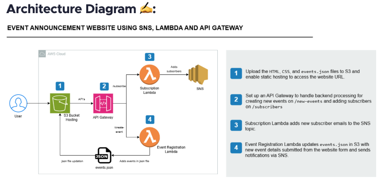
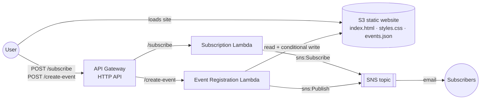

# Serverless Event Announcement Website

## Overview

Small communities, such as meetup groups, study circles and clubs, need a simple way to post upcoming events and tell people about them. Running a web server and a mailing list for that costs money and takes upkeep.

This project is a fully serverless website where visitors can:

- **View** a list of upcoming events
- **Create** a new event through a form
- **Subscribe** by email and get a notification whenever a new event is posted

There are no servers to patch and nothing runs while the site is idle. Every component is a managed AWS service that bills per request, so a low-traffic site costs close to nothing.

## Architecture





## Technologies

- **Amazon S3**: static website hosting and storage for `events.json`
- **Amazon API Gateway (HTTP API)**: REST endpoints for the frontend, with CORS
- **AWS Lambda (Python 3.13, boto3)**: backend logic
- **Amazon SNS**: email subscriptions and notifications
- **AWS IAM**: least-privilege roles and the bucket policy
- **Amazon CloudWatch Logs**: Lambda logs
- **AWS CLI + Bash**: automated deployment and teardown
- **HTML, CSS, vanilla JavaScript**: frontend, with no build step

## Architecture Explanation

| # | Component | What it does |
|---|---|---|
| 1 | **S3 static website** | Serves `index.html`, `styles.css` and `events.json`. On page load, the browser fetches `events.json` from the bucket and shows the events. |
| 2 | **API Gateway (HTTP API)** | Exposes `POST /subscribe` and `POST /create-event` and forwards each request to its Lambda. It also answers CORS preflight requests, because the API runs on a different domain from the S3 website. |
| 3 | **Subscription Lambda** | Validates the email address and calls `sns:Subscribe` with the `email` protocol. SNS then emails the subscriber a confirmation link. Nothing is delivered until they click it. |
| 4 | **Event Registration Lambda** | Validates the event (title, date, description). It reads `events.json` from S3, appends the event and writes the file back with an S3 conditional write (`If-Match` on the ETag). Then it publishes a notification to the SNS topic. |
| 5 | **SNS topic** | Fans each new event out by email to every confirmed subscriber. |

**Request flow when someone creates an event:**

1. The browser sends `POST /create-event` to API Gateway, which calls the Event Registration Lambda.
2. The Lambda reads `events.json` and its ETag, appends the event, and writes the file back only if the ETag still matches.
3. On success, the Lambda publishes the event to SNS, and SNS emails every confirmed subscriber.
4. The browser reloads `events.json`, so the new event appears in the list.

**Why these design choices:**
- **A JSON file in S3 instead of a database:** it keeps the site fully static and matches the lab's goal. The conditional write stops two simultaneous submissions from overwriting each other, which is the main risk of keeping data in a single file.
- **An HTTP API instead of a REST API:** it's cheaper and has built-in CORS. It also needs less setup for plain Lambda proxy routes.

## Repository Structure

```
event-announcement/
├── frontend/
│   ├── index.html          # Page markup + JS: loadEvents(), subscribeToEvents(), submitNewEvent(event)
│   ├── styles.css          # Styling
│   └── events.json         # Starting events (uploaded once; the Lambda maintains it afterwards)
├── lambdas/
│   ├── subscribe/          # Subscription Lambda
│   └── create_event/       # Event Registration Lambda
├── iam/
│   ├── lambda-trust-policy.json         # Lets Lambda assume the roles
│   ├── subscribe-lambda-policy.json     # sns:Subscribe on the topic only
│   ├── create-event-lambda-policy.json  # s3:Get/PutObject on events.json only, sns:Publish on the topic only
│   └── s3-bucket-policy.json            # Public read for the website
├── scripts/
│   ├── deploy.sh           # Creates/updates the whole stack (safe to re-run)
│   └── teardown.sh         # Deletes everything deploy.sh created
├── tests/
│   └── test_lambdas.py     # Unit tests for both Lambdas against fake S3/SNS
└── documentation/
    ├── README.md                # Index: every AWS resource used and how they fit together
    ├── 01-amazon-s3.md
    ├── 02-amazon-api-gateway.md
    ├── 03-aws-lambda.md
    ├── 04-amazon-sns.md
    ├── 05-aws-iam.md
    ├── 06-amazon-cloudwatch-logs.md
    └── architecture.png
```

Each file in [documentation/](documentation/) explains what the resource is, why this project needs it, how it's configured, and how to inspect it.

## Prerequisites

- An AWS account and an IAM user or role that can manage S3, SNS, Lambda, API Gateway, IAM and CloudWatch Logs
- [AWS CLI v2](https://docs.aws.amazon.com/cli/latest/userguide/getting-started-install.html), configured with credentials (`aws configure`)
- `bash` and `zip`. Both come with macOS and most Linux distributions.
- Python 3.10+, needed only to run the unit tests
- An email address you can access, to confirm the SNS subscription

Check your setup:

```bash
aws sts get-caller-identity   # should print your account and user
```

## Deployment

### Option A: Automated (recommended)

```bash
./scripts/deploy.sh
# Optional overrides:
AWS_REGION=eu-west-1 PROJECT=my-events ./scripts/deploy.sh
```

The script runs these steps in order:

1. Creates the S3 bucket `<project>-site-<account-id>-<region>`, enables static website hosting and applies the public-read bucket policy.
2. Creates the SNS topic `<project>-notifications`.
3. Creates one IAM role per Lambda and attaches its least-privilege inline policy and `AWSLambdaBasicExecutionRole`.
4. Zips and deploys both Lambda functions, with environment variables for the topic ARN and bucket name.
5. Creates the HTTP API, Lambda integrations, both routes and the `$default` stage with auto-deploy. It also grants API Gateway permission to invoke each function.
6. Puts the API URL into `index.html` and uploads the frontend. It uploads `events.json` only if the bucket doesn't already have one.

It ends by printing the website URL, the API URL and the topic ARN.

Then verify the deployment:

1. Open the website URL and click **Subscribe to Events**. Enter your email and click the confirmation link that AWS sends.
2. Click **Create Event**, fill in the form and submit. The event appears in the list and a notification arrives by email.

### Option B: Manual (AWS Console)

1. **SNS:** create a Standard topic and copy its ARN.
2. **S3:**
   - Create a bucket and turn off *Block all public access*.
   - Enable *Static website hosting* with index document `index.html`.
   - Paste `iam/s3-bucket-policy.json` as the bucket policy, replacing `__BUCKET_NAME__`.
3. **IAM:**
   - Create two roles with the trust policy `iam/lambda-trust-policy.json`.
   - Attach `AWSLambdaBasicExecutionRole` to both.
   - Add the matching inline policy from `iam/`, replacing the placeholders.
4. **Lambda:** create two Python 3.13 functions from the files in `lambdas/`. Set these environment variables:
   - Subscribe: `SNS_TOPIC_ARN`
   - Create event: `SNS_TOPIC_ARN`, `BUCKET_NAME`, `EVENTS_KEY=events.json`
5. **API Gateway:**
   - Create an HTTP API with routes `POST /subscribe` and `POST /create-event`, each with a Lambda integration.
   - Enable CORS: origin `*`, methods `POST, OPTIONS`, header `content-type`.
   - Use the `$default` stage with auto-deploy.
6. **Frontend:**
   - In `frontend/index.html`, replace `__API_BASE_URL__` with the API invoke URL (no trailing slash).
   - Upload `index.html`, `styles.css` and `events.json` to the bucket.

## CI/CD

This project has **no CI/CD pipeline yet**. Deployment runs from a workstation with `scripts/deploy.sh`. The script can be re-run safely: it reuses existing resources and updates the Lambda code and frontend in place.

A pipeline for this project would use GitHub Actions:

1. **On pull request:**
   - Run `python3 tests/test_lambdas.py`.
   - Run `bash -n` and `shellcheck` on the scripts.
   - Run a lint step on the IAM JSON files.
2. **On merge to `main`:**
   - Authenticate to AWS with **GitHub OIDC**, which avoids long-lived access keys.
   - Run `scripts/deploy.sh`.
   - Run a smoke test: `curl` the website URL and `POST` an invalid payload to both endpoints, expecting `400`.

## Security

- **Least-privilege IAM:** each Lambda has its own role. The subscription role can only call `sns:Subscribe` on this one topic. The event role can only call `s3:GetObject` and `s3:PutObject` on `events.json` (not the whole bucket) and `sns:Publish` on this topic. Both roles also get `AWSLambdaBasicExecutionRole` for CloudWatch Logs.
- **Scoped invoke permissions:** API Gateway may invoke each function only through its own route. The `--source-arn` is limited to `<api-id>/*/*/subscribe` or `/create-event`.
- **Public S3 access:** the bucket policy allows only anonymous `s3:GetObject`. Public listing and public writes are denied, and object ACLs stay blocked (`BlockPublicAcls` and `IgnorePublicAcls` remain on). Only the Event Lambda can write `events.json`.
- **Input validation:** both Lambdas validate input on the server. Emails are checked against a pattern. Event fields are required, have length limits (title 120, description 1000) and dates must be ISO `YYYY-MM-DD`. Bad input returns `400` without revealing internal details.
- **XSS protection:** event text is rendered with `textContent`, never `innerHTML`, so submitted HTML or script is never executed.
- **Secrets:** none are stored in code. The topic ARN and bucket name are passed as Lambda environment variables, and the API URL is public by design.
- **Known gaps** (acceptable for a lab, not for production):
  - The API has no authentication, so anyone with the URL can create events and email all subscribers.
  - CORS allows `*`.
  - The S3 website endpoint is HTTP only.

  See [Future Improvements](#future-improvements).

## Monitoring

- **Logs:** each Lambda writes to CloudWatch Logs at `/aws/lambda/<project>-subscribe` and `/aws/lambda/<project>-create-event`. Failed SNS or S3 calls and write-conflict retries are logged with details.

  ```bash
  aws logs tail /aws/lambda/event-announcement-create-event --follow
  ```

- **Metrics:** CloudWatch collects these by default:
  - Lambda: `Invocations`, `Errors`, `Duration`, `Throttles`
  - API Gateway: `Count`, `4xx`, `5xx`, `Latency`
  - SNS: `NumberOfMessagesPublished`, `NumberOfNotificationsFailed`
- **Alerts:** none are configured yet. The recommended first alarms are:
  - Lambda `Errors > 0` over 5 minutes
  - API Gateway `5xx > 0`
  - SNS `NumberOfNotificationsFailed > 0`

  Each alarm would notify a separate ops SNS topic.

## Troubleshooting

| Problem | Cause | Fix |
|---|---|---|
| Event form sent an empty title | `form.title` returns the `<form>` element's own `title` attribute, not the input named `title` | Read fields through `form.elements.title` instead |
| `create-function` fails with *"The role defined for the function cannot be assumed by Lambda"* | IAM roles take a few seconds to propagate after creation | `deploy.sh` waits 15 seconds after creating roles and retries `create-function` up to 6 times |
| New event saved but not shown after refresh | The browser or S3 served a cached `events.json` | `events.json` is written with `Cache-Control: no-cache`, and the page fetches it with a `?t=<timestamp>` cache-buster |
| Two events submitted at once and one disappeared (risk) | Read-modify-write on a single S3 file is a race condition | Conditional `PutObject` with `If-Match: <ETag>`, retrying up to 5 times on `412 PreconditionFailed` |
| Browser shows a CORS error | API on a different domain from the site, and the preflight `OPTIONS` was not answered | CORS configured on the HTTP API (`AllowOrigins=*`, `AllowMethods=POST,OPTIONS`, `AllowHeaders=content-type`) |
| Website URL returns 404 or "no such bucket" | Older regions use `s3-website-<region>`, newer ones `s3-website.<region>` | `deploy.sh` builds the right endpoint format for the region |
| Subscribed but no emails arrive | The SNS subscription is still *Pending confirmation* | Click the link in the AWS confirmation email, and check spam |
| `403 Forbidden` on the website | Block Public Access is still on, or the bucket policy is missing | Re-run `deploy.sh`, or check *Permissions → Block public access* in the console |
| Page says *"The API URL isn't configured yet"* | `index.html` was uploaded by hand with the `__API_BASE_URL__` placeholder | Replace the placeholder with the API invoke URL, or deploy with the script |

## Testing

**Unit tests:** [tests/test_lambdas.py](tests/test_lambdas.py) runs both handlers against in-memory fakes of S3 and SNS, so no AWS account or boto3 install is needed.

```bash
python3 tests/test_lambdas.py
```

They cover:
- **Valid subscription:** the email is normalized to lowercase and `sns:Subscribe` is called with the email protocol.
- **Invalid input:** bad emails, malformed JSON, missing fields, a wrong date format and a non-object body each return `400`.
- **First event:** writing the first event uses `If-None-Match: *` (create only).
- **Concurrent write:** a simulated `PreconditionFailed` makes the Lambda re-read and retry, and both events survive.
- **Notification:** the SNS message contains the formatted date.

**Static checks:**

```bash
for f in scripts/*.sh; do bash -n "$f"; done                 # shell syntax
python3 -m py_compile lambdas/*/lambda_function.py           # Python syntax
python3 -c "import json,glob;[json.load(open(f)) for f in glob.glob('iam/*.json')+['frontend/events.json']]"
```

**End-to-end (manual, after deploying):**
- [ ] The website loads and shows the seeded events.
- [ ] Subscribe → AWS confirmation email arrives → confirm.
- [ ] Create an event → it appears in the list → a notification email arrives.
- [ ] Submit the form with a field blank → you see an error, and nothing is saved.
- [ ] `curl -X POST <api>/create-event -d '{}'` returns `400`.

## Cost Considerations

At lab traffic levels this stack costs nothing or a few cents a month. Most usage fits in the AWS Free Tier.

| Resource | What you pay for | Notes |
|---|---|---|
| S3 | Storage + GET/PUT requests + data transfer out | A few KB of files, so negligible |
| Lambda | Requests + GB-seconds | Free tier includes 1M requests per month |
| API Gateway (HTTP API) | Per million requests | Cheaper than REST APIs |
| SNS | Email notifications | Free tier includes 1,000 email deliveries per month |
| CloudWatch Logs | Log ingestion + storage | Logs are kept forever by default. Set a retention period or delete the log groups. |
| IAM | Free | |

Main cost risks:
- **Abuse of the public API:** anyone could spam `/create-event`, which triggers emails to every subscriber. Add throttling or authentication (see below).
- **Logs that are never deleted:** CloudWatch logs pile up over time. Run [Cleanup](#cleanup) when you're done.

## Lessons Learned

- **Managed services remove most infrastructure work.** The system has no servers, but it still needs IAM roles, invoke permissions, CORS and caching to be correct. Those are where most of the work goes.
- **A file used as a database needs concurrency control.** Read-modify-write on `events.json` would silently lose events under concurrent writes. S3 conditional writes (`If-Match` / `If-None-Match`) solve this without adding a database.
- **IAM is eventually consistent.** A role you just created can't be used right away, so automation needs a wait or retries.
- **SNS email subscriptions need double opt-in.** Subscribers must confirm before they get anything, which protects against people being subscribed without consent.
- **Least privilege can be scoped to a single object.** The write permission covers only `events.json`, not the whole bucket.
- **Idempotent scripts make iteration safe.** Look up resources before creating them and never overwrite live data (`events.json`). That way the deploy script can be re-run after every change.
- **Small DOM details matter.** `form.title` returns the form's own `title` attribute, not the input named `title`. Reading fields through `form.elements` avoids this.

## Future Improvements

What would change for production:

1. **Infrastructure as Code:** replace the CLI script with Terraform or AWS SAM/CDK to get state tracking, drift detection and reviewable plans.
2. **Database:** store events in DynamoDB instead of a JSON file, with an API to list events. This scales and allows queries such as upcoming events only.
3. **Authentication:** protect `/create-event` with a Cognito JWT authorizer so only signed-in organizers can post. Add an approval step before notifications go out.
4. **Abuse protection:** API Gateway throttling, AWS WAF rate-based rules, and CAPTCHA on the forms.
5. **HTTPS and a custom domain:** CloudFront with Origin Access Control in front of a private bucket, an ACM certificate and Route 53.
6. **Restricted CORS:** allow only the site's own domain instead of `*`.
7. **CI/CD:** the GitHub Actions pipeline described above, using OIDC.
8. **Observability:**
   - CloudWatch alarms and a dashboard
   - Structured JSON logs
   - X-Ray tracing
   - A log retention policy
9. **Better emails:** SES with HTML templates and one-click unsubscribe, or SNS filter policies so people can subscribe to certain categories of events.
10. **Frontend:** an in-page subscribe form instead of `prompt()`, plus event editing and deletion.

## Cleanup

Delete everything the deploy created:

```bash
./scripts/teardown.sh
# If you deployed with overrides, pass the same ones:
AWS_REGION=eu-west-1 PROJECT=my-events ./scripts/teardown.sh
```

The script asks for confirmation, then deletes these resources:
- The API Gateway HTTP API
- Both Lambda functions
- Both IAM roles and their policies
- The SNS topic and all its subscriptions
- The S3 bucket and every object in it, including events created through the site
- The Lambda CloudWatch log groups

Check that nothing is left:

```bash
aws s3 ls | grep event-announcement
aws lambda list-functions --query "Functions[?starts_with(FunctionName,'event-announcement')].FunctionName"
aws sns list-topics | grep event-announcement
aws apigatewayv2 get-apis --query "Items[?Name=='event-announcement-api'].ApiId"
```
