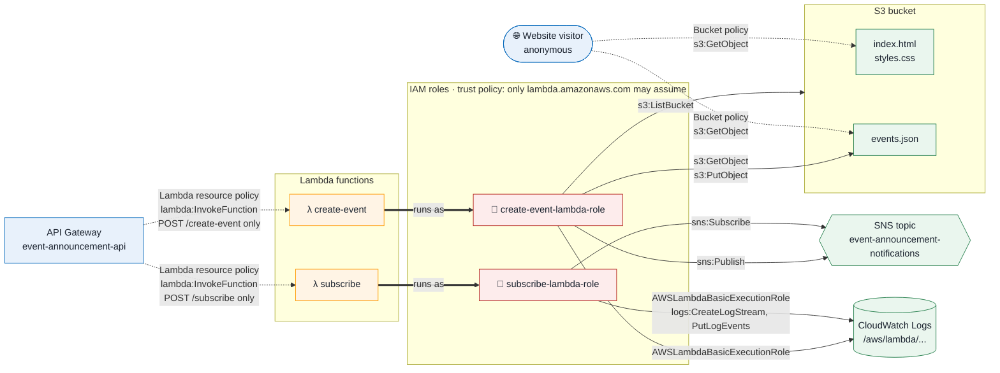

# AWS IAM (Identity and Access Management)

## What it is

IAM controls **who can do what to which AWS resource**. Every AWS API call is checked against IAM policies. If no policy allows an action, it's denied.

## Why this project needs it

By default, no AWS component can access any other. Lambda can't write to S3, API Gateway can't invoke Lambda, and anonymous users can't read S3. IAM grants exactly the access the project needs, and no more:

| Who | Needs to | Granted by |
|---|---|---|
| Subscription Lambda | Add emails to the SNS topic | IAM role + inline policy |
| Event Registration Lambda | Read and write `events.json`, publish to SNS | IAM role + inline policy |
| Both Lambdas | Write logs to CloudWatch | AWS managed policy `AWSLambdaBasicExecutionRole` |
| API Gateway | Invoke each Lambda | Resource-based policy on each Lambda |
| Anyone on the internet | Read the website files | S3 bucket policy |

The guiding rule is **least privilege**. If any one component were compromised, the damage it could do would be limited to its own small job.

## Access diagram



**How to read it:**

| Arrow | Meaning | Where the permission lives |
|---|---|---|
| `-.->` dashed | **Resource-based policy:** the resource says who may access it | On the S3 bucket or the Lambda function |
| `==>` thick | **Runs as:** the function uses its role's permissions. The role's trust policy allows only the Lambda service to assume it. | On the IAM role (trust policy) |
| `-->` solid | **Identity-based policy:** the role says what it may do | On the IAM role (inline or managed policy) |

> The diagram is written in Mermaid. GitHub draws it automatically. In VS Code, install the *Markdown Preview Mermaid Support* extension to see it in the preview.

### Who can access what

Anything not marked ✅ is denied, because IAM denies by default.

| | `index.html` / `styles.css` | `events.json` | SNS topic | Lambda functions | CloudWatch Logs |
|---|---|---|---|---|---|
| **Website visitor** | ✅ read | ✅ read | ❌ | ❌ (only through API Gateway) | ❌ |
| **API Gateway** | ❌ | ❌ | ❌ | ✅ invoke, each function only from its own route | ❌ |
| **subscribe Lambda** | ❌ | ❌ | ✅ `Subscribe` only | ❌ | ✅ write own logs |
| **create-event Lambda** | ❌ cannot overwrite the site | ✅ read + write | ✅ `Publish` only | ❌ | ✅ write own logs |

Key points the diagram shows:
- **Visitors can only read S3 directly.** Every change goes through API Gateway, then a Lambda, and the Lambda's role decides what's allowed.
- **The two roles don't overlap.** Only the subscribe role can add subscribers, and only the create-event role can write data or send emails.
- **The create-event role's write access is limited to `events.json`.** A bug in that function can't deface `index.html`.

## What was created

### 1. Lambda trust policy: [iam/lambda-trust-policy.json](../iam/lambda-trust-policy.json)

```json
{ "Effect": "Allow", "Principal": { "Service": "lambda.amazonaws.com" }, "Action": "sts:AssumeRole" }
```

A trust policy says **who may use a role**. This one lets only the Lambda service assume the roles, so a user or another service can't borrow them. Both roles use it.

### 2. Role `event-announcement-subscribe-lambda-role`

| Policy | Type | Grants |
|---|---|---|
| `AWSLambdaBasicExecutionRole` | AWS managed | `logs:CreateLogGroup`, `logs:CreateLogStream`, `logs:PutLogEvents` |
| `event-announcement-subscribe-lambda-role-inline` | Inline, from [iam/subscribe-lambda-policy.json](../iam/subscribe-lambda-policy.json) | `sns:Subscribe` on **this topic only** |

This role **can't** read S3, publish to SNS or touch any other topic. That matters because this function takes arbitrary input from the internet.

### 3. Role `event-announcement-create-event-lambda-role`

| Policy | Type | Grants |
|---|---|---|
| `AWSLambdaBasicExecutionRole` | AWS managed | CloudWatch Logs (as above) |
| `event-announcement-create-event-lambda-role-inline` | Inline, from [iam/create-event-lambda-policy.json](../iam/create-event-lambda-policy.json) | See below |

```json
{ "Action": ["s3:GetObject", "s3:PutObject"], "Resource": "arn:aws:s3:::<bucket>/events.json" }
{ "Action": "s3:ListBucket",                  "Resource": "arn:aws:s3:::<bucket>" }
{ "Action": "sns:Publish",                    "Resource": "<topic-arn>" }
```

- **Read and write on one object only:** the function can change `events.json` but not `index.html`. That means a bug or exploit in it can't deface the website.
- **`s3:ListBucket`:** without it, S3 returns `403 Access Denied` instead of `404 Not Found` when `events.json` is missing. The Lambda relies on the 404 to know it should create the file.
- **`sns:Publish` on one topic only:** the function can't subscribe or unsubscribe anyone, and can't publish elsewhere.

### 4. Lambda resource-based permissions (API Gateway → Lambda)

These are attached to each **function**, not to a role. They're created by `aws lambda add-permission` in `deploy.sh`:

| Function | Principal | Source ARN |
|---|---|---|
| `event-announcement-subscribe` | `apigateway.amazonaws.com` | `arn:aws:execute-api:us-east-1:<account>:<api-id>/*/*/subscribe` |
| `event-announcement-create-event` | `apigateway.amazonaws.com` | `arn:aws:execute-api:us-east-1:<account>:<api-id>/*/*/create-event` |

The source ARN restricts each permission to **this API and this route**. Another API Gateway, even one in the same account, can't invoke the functions.

### 5. S3 bucket policy: [iam/s3-bucket-policy.json](../iam/s3-bucket-policy.json)

```json
{ "Effect": "Allow", "Principal": "*", "Action": "s3:GetObject", "Resource": "arn:aws:s3:::<bucket>/*" }
```

This gives public **read-only** access, which a public website needs. It grants no `ListBucket`, so visitors can't list the files, and no `PutObject` or `DeleteObject`.

## Templates and placeholders

The JSON files in [iam/](../iam/) contain the placeholders `__BUCKET_NAME__` and `__TOPIC_ARN__`, so the repository holds no account-specific values. `deploy.sh` fills them in, writes the results to `.build/`, and uploads those copies.

## Two kinds of IAM policy used here

| | Identity-based policy | Resource-based policy |
|---|---|---|
| Attached to | A role, user or group | The resource itself (a Lambda function or S3 bucket) |
| Answers | "What can **this role** do?" | "Who can access **this resource**?" |
| Used here for | Lambda → S3, Lambda → SNS, Lambda → Logs | API Gateway → Lambda, public → S3 |

## Alternatives considered

| Option | Why it wasn't used |
|---|---|
| One shared role for both Lambdas | Simpler, but the subscribe function would get S3 write and SNS publish access it doesn't need |
| AWS managed policies like `AmazonS3FullAccess` or `AmazonSNSFullAccess` | Far too broad: they grant every bucket and every topic in the account |
| Wildcard resources (`"Resource": "*"`) | Same problem. Every statement here names one specific resource. |

## Cost

IAM is free.

## Inspect it

**CLI:**
```bash
R=event-announcement-create-event-lambda-role
aws iam get-role --role-name $R --query Role.AssumeRolePolicyDocument
aws iam list-attached-role-policies --role-name $R
aws iam get-role-policy --role-name $R --policy-name $R-inline
aws lambda get-policy --function-name event-announcement-create-event   # resource-based policy
```

**Console:**
- Go to **IAM**, then **Roles**, then the role name. The **Permissions** tab shows its policies and the **Trust relationships** tab shows the trust policy.
- Go to **Lambda**, then the function, then **Configuration → Permissions**, and scroll to *Resource-based policy statements*.

## Cleanup

`scripts/teardown.sh` removes everything in this order:
1. Deletes each inline policy.
2. Detaches the managed policy.
3. Deletes the role. A role can't be deleted while it still has policies.
4. The Lambda resource-based permissions disappear along with the functions.
5. The bucket policy disappears along with the bucket.
